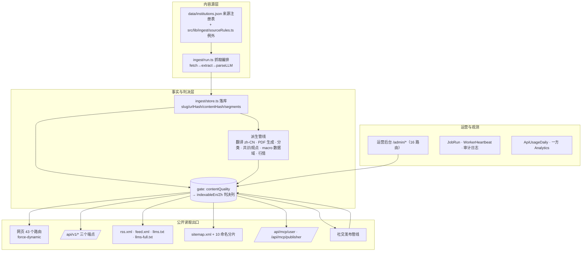

# 01 · 当前架构与依赖图

> 证据标准：代码以 `文件:行号` 为准；`ARCHITECTURE.md` 仅作意图参考（其过期点见 §6）。
> 本审计基于 `main@38a3019`（2026-10-16）。

## 1. 技术栈与运行事实

| 层 | 事实 | 证据 |
|---|---|---|
| 框架 | Next.js 15.5.27（App Router，`distDir` 可切）、React 19.3、TypeScript 5.6 | `package.json:93,101-102`；`next.config.mjs:30-36` |
| 数据 | Prisma 5.22；开发 SQLite（`file:./dev.db`）、生产 PostgreSQL 16；**72 个模型** | `.env:1`；`prisma/schema.prisma`；`Dockerfile:32-35` |
| 样式 | **无 Tailwind**；自研 CSS：`src/app/globals.css`（1305 行）+ `src/app/admin/admin.css`（516 行），CSS 变量双主题 | `globals.css:4-38` |
| 测试 | node:test + tsx，**108 个测试文件 / 620 项**，全绿（2026-10-16） | `package.json:10`；`npm test` |
| MCP | 官方 SDK 1.32.1 + zod 4，两个无状态 Streamable HTTP 端点 | `package.json`；`src/lib/mcp/`（10 文件） |
| 部署 | 单镜像多进程：app + scheduler + macro-scheduler + social-scheduler + backup + db（6 容器）；Caddy 唯一入口 | `docker-compose.prod.yml`；`Dockerfile:40` |
| 发布路径 | **无 CI**（Actions 无额度）：工作站 `git archive` → scp → VPS `docker build` → compose `up -d`；迁移由 app 启动命令 `db:postgres:deploy` 应用 | 会话记录；`Dockerfile:40` |
| 运行形态 | 全站 `force-dynamic`（53 处），**无 ISR / unstable_cache**；页面每请求实时查库 | 全站扫描（2026-10） |

## 2. 系统分层与依赖图

**一句话依赖原则**：所有公开出口（页面、API、RSS、sitemap、MCP、社交）必须经 `publicationReadyWhere()`（`src/lib/publication.ts:46-62`）读取，它同时检查 `rawText`、`withdrawnAt`、英文文档与判决列。**新页面绕过它就是引入 NOINDEX 页广告缺陷**（2026-10 修复过的整类缺陷）。

## 3. 核心机制清单（重构必须沿用的不变量）

| 机制 | 位置 | 新页面必须知道的事 |
|---|---|---|
| 公开闸门 | `src/lib/contentQuality.ts:69`（纯函数）+ `src/lib/gate.ts`（物化到列） | 判决由输入变化触发重算（`refreshGate`），列表/sitemap 读列、详情页实时算——两者永远一致 |
| 研报寻址 | `src/lib/researchPath.ts`（`buildResearchSlug`，slug 不可变；id→slug 308） | 不改 slug 生成；新页面用 `researchPath(article)` |
| 双语路由 | `src/middleware.ts`（`/zh` `/en` 前缀、legacy topic/asset 跳转、`PRIVATE_PREFIXES` 反缓存） | 新路由默认两语言前缀；canonical/hreflang 由 `src/lib/seo.tsx` 生成 |
| sitemap 分片 | `src/lib/sitemap.ts`（pages/institutions/assets/topics/research-{lang}-{n}，20k/片，判决列驱动） | 新归档页若要进 sitemap，需在此注册并过闸门 |
| 搜索 | `src/lib/search.ts`（版本化内存索引 + 拼音/别名） | `/api/search` noindex；重建已有失效钩子 `invalidateSearchIndex()` |
| 翻译 | `src/lib/translation/` + `prisma/translate.ts` | 新文章进入既有队列**即产生 LLM 费用**；zh 页 gate 依赖译文质量分 |
| PDF | `src/lib/documents/pdf.ts`（`generateArticleDocuments`） | 每个可索引研报必须有 ready 英文文档；MCP 发布路径已接入 |
| Macro 域 | `src/lib/macro/`（50 文件 + 23 测试） | 独立于 Article；展示层单位/期次问题见 03 文档风险表 |
| MCP | `src/lib/mcp/` | 发布能力 2026-10-16 上线（`publisher:publish`），走同一闸门；撤下仍只有 CLI `withdraw` |
| 权限 | `src/lib/permissions.ts`（`can()`） | tier 与 role 分离；页面/service 统一入口 |

## 4. 代码规模与模块

| 模块 | 源文件 | 测试 | 说明 |
|---|---|---|---|
| `src/lib` 根 | 53 | — | queries/publication/gate/seo/i18n/search/viewRanking 等 |
| `src/lib/macro/` | 50 | 23 | 最大的域，含 providers/calendar/watch/forecasts |
| `src/lib/ingest/` | 18 | 11 | 采集全链（run.ts 含 ~620 行单函数，改动风险高） |
| `src/lib/decision/` | 12 | 2 | 决策影子评估 |
| `src/lib/mcp/` | 10 | 4 | MCP 两端与域服务 |
| `src/lib/llm/` | 8 | 3 | 四家 provider + 预算熔断 |
| 其余（analytics/classification/documents/social/prices/reports/translation） | 27 | 21 | |
| `src/app/_components/` | 11 组件 | — | 见 04 文档复用表 |

## 5. 全站性能与已知热点（重构前的技术债，与 PRD NFR 直接相关）

- 全站无缓存层：Caddy 仅反代，`s-maxage` 头不落地；`loadTopicIndex` 原先每请求全量聚合（已加 5 分钟 TTL 缓存，`src/lib/topics.ts`）。
- `/research` 列表在应用层全表排序分页（`src/app/research/page.tsx:118-130`）；正确修法需物化 `displayAt` 列（设计文档在案）。
- 首页 `/research` 等列表页每 PV 多查询；OG 图每请求 satori 渲染（`src/app/api/og/route.tsx`）。
- 详情页重复查询与三遍正则门控（`generateMetadata` + page 各算一次）。

结论：**PRD 的 LCP ≤2.5s 目标在当前"全动态 + 无缓存"形态下无法仅靠 CSS/组件层达成**，性能投资（TL-404）应排在内容页改造之前或同时。

## 6. ARCHITECTURE.md 过期点（审计以代码为准）

| 位置 | 过期陈述 | 现状 |
|---|---|---|
| `ARCHITECTURE.md:3` | "Draft v1 · 2026-08-27" | §13 已于 09-27 重写 |
| `L6,L26,L255,L421,L480` | 多处"MVP"措辞 | 站点已上线、采集全自动、OAuth 已接 |
| `L73-76` | `documents/`、`permissions.ts` 标"目标新增" | 均已实现并带测试 |
| `L128` | ETag/Last-Modified 标"后续" | `ingest/fetch.ts` 已做条件请求与磁盘缓存 |
| `L543` | Worker/队列未做 | 三个 scheduler 容器已运行（JobRun + heartbeat） |
| `L556` vs 附录 `L594-602` | 生产价格源"待办" vs 附录称已落地 | 附录为准（行情链路已运行） |
| `L144` vs `L25` | "59 候选源" vs "64 家机构" | 口径不同未统一（见 03 文档 §4） |
